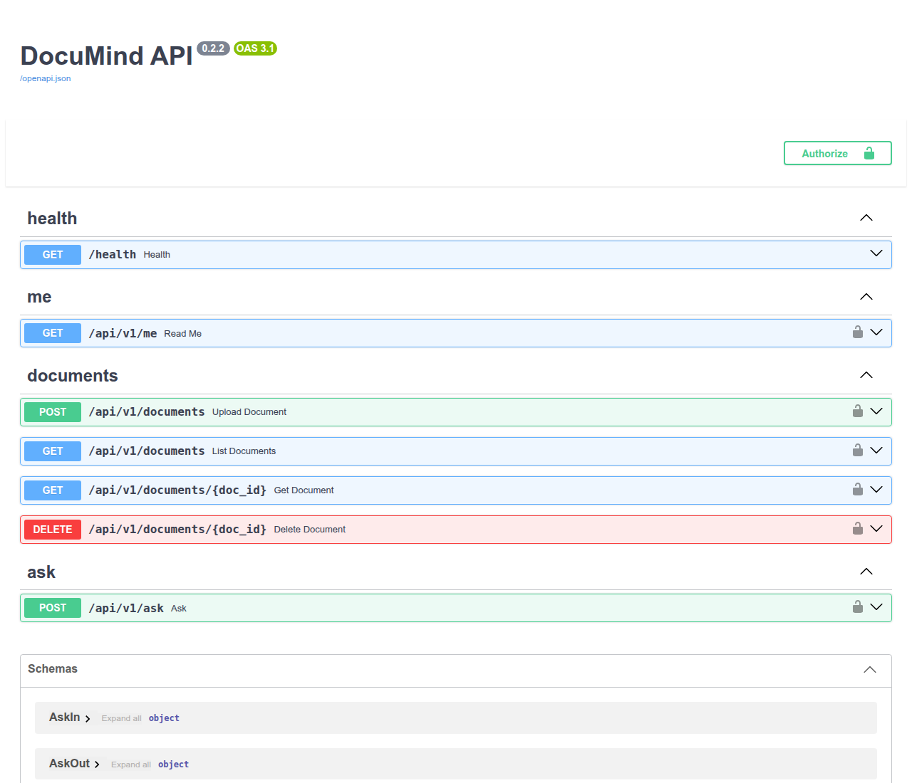
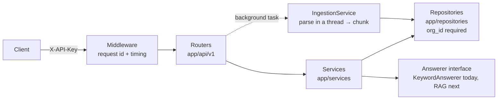

# DocuMind API

A multi-tenant FastAPI backend where each company uploads its own documents and asks questions answered only from those documents, with cited sources.

It is the skeleton of a RAG system, built in public, step by step. The pipeline is in place (upload → chunking → retrieval with sources); retrieval is keyword-based for now, and the LLM plugs into a single interface next.

**Arabic version:** [README.ar.md](README.ar.md)



## Highlights

- **Multi-tenant from day one:** every repository method requires `org_id`, and another tenant's document returns `404`, not `403`.
- **Async document processing:** uploads return `202 Accepted`; chunking runs in the background and the document moves from `processing` to `ready` or `failed`.
- **PDF support:** text is extracted with PyMuPDF in a worker thread (`asyncio.to_thread`), so parsing never blocks the event loop.
- **Idempotent uploads:** an `Idempotency-Key` header makes retries return the same document instead of a duplicate.
- **Daily quota per tenant:** questions over the limit return `429 quota_exceeded`.
- **One error shape everywhere:** stable codes, Arabic messages, and a request ID that matches the logs. Stack traces never reach the client.
- **Typed frontend contract:** TypeScript types are generated from the OpenAPI spec, and a test fails if they go stale.

## Architecture



The rule: routers never talk to repositories directly. Routers handle HTTP, services hold the business logic, and repositories own storage (in memory for now, PostgreSQL next).

## Endpoints

Every route under `/api/v1` requires the `X-API-Key` header. Any route can also return `500` with a generic message.

| Method | Path | Purpose | Success | Errors |
| --- | --- | --- | --- | --- |
| GET | `/health` | Status and version, no key needed | 200 | |
| GET | `/api/v1/me` | The company behind the API key | 200 | 401 |
| POST | `/api/v1/documents` | Upload `.txt`, `.md` or `.pdf` (max 2 MB), optional `Idempotency-Key` | 202 | 401, 413, 422 |
| GET | `/api/v1/documents` | List documents, filter by `status`, cursor pagination | 200 | 401, 422 |
| GET | `/api/v1/documents/{doc_id}` | One document and its processing status | 200 | 401, 404 |
| DELETE | `/api/v1/documents/{doc_id}` | Delete the document, its file and its chunks | 204 | 401, 404 |
| POST | `/api/v1/ask` | Answer a question from the company's own documents, with sources | 200 | 401, 422, 429 |

Every error has the same shape:

```json
{
  "error": {
    "code": "quota_exceeded",
    "message": "خلصت حد الأسئلة النهارده (20 سؤال)، جرّب تاني بكره",
    "request_id": "3f2a9c..."
  }
}
```

The same `request_id` is sent back in the `X-Request-Id` header and appears on every log line of that request.

## Design decisions and why

**Why `202 Accepted` for uploads?**
Chunking can be slow, so the upload is stored and acknowledged right away, and processing happens after the response. The client polls the document until it is `ready` or `failed`. Because nobody is waiting on the background work, failures are recorded on the document itself (`error`) instead of being lost.

**Why `404` and not `403` for another tenant's document?**
A `403` says "this exists, but it is not yours", which lets anyone probe which IDs exist. A `404` gives the same answer for "missing" and "not yours". Isolation lives in the repositories, where every method requires `org_id`, so even a missed check higher up cannot leak data.

**Why cursor pagination instead of offset?**
With `?offset=20`, adding or deleting documents between two requests shifts the pages, so items get skipped or repeated. A cursor (`?after=<last id>`) continues exactly after the last item seen, using a stable order of `(created_at, id)`. It also maps to an indexed range query once the data moves to PostgreSQL.

**Why an `Answerer` interface?**
The `/ask` router only knows `answer(org_id, question) -> Answer`. Switching from keyword search to an LLM means one new class and one changed line in `get_answerer`. The method is already `async` and the answer already has a `usage` field, so the router will not change when the network-bound LLM arrives.

**Why parse files in a thread?**
Parsing a PDF is CPU work with no `await`, so running it on the event loop would freeze every other request. `asyncio.to_thread` hands it to a worker thread. A test proves it: a concurrent task keeps ticking while a slow parse runs, and stops ticking without the thread.

**Why count the question before answering?**
Reserving the quota first means concurrent requests cannot overshoot the limit, which matters once each answer costs LLM tokens. Invalid questions are rejected with `422` before the quota is touched.

**Why is background processing safe to run twice?**
A job queue can deliver the same job again if a worker dies midway. Ingestion deletes a document's old chunks before saving new ones, so a second run gives the same result instead of duplicates.

## Known limitations

These are deliberate for this stage, and each one has a planned fix.

- **Storage is in memory:** data is lost on restart. PostgreSQL with migrations is next.
- **Background tasks run inside the API process:** a crash mid-processing loses the job. A persistent job queue will replace them.
- **Retrieval is keyword overlap:** no embeddings and no LLM yet.
- **Arabic PDFs:** Unicode NFKC normalization fixes letters stored as presentation forms, but lam-alef ligatures can still be extracted in reverse order.

## Getting started

Requires Python 3.12+ and [uv](https://docs.astral.sh/uv/).

```bash
uv sync
cp .env.example .env    # then change the API keys
uv run fastapi dev
```

Open <http://127.0.0.1:8000/docs>, click **Authorize** and paste a company's API key.

```bash
curl -X POST localhost:8000/api/v1/documents \
  -H "X-API-Key: dev-acme-change-me" -F "file=@contract.pdf"

curl -X POST localhost:8000/api/v1/ask \
  -H "X-API-Key: dev-acme-change-me" -H "Content-Type: application/json" \
  -d '{"question": "What is the contract duration?"}'
```

## Configuration

| Variable | Default | Meaning |
| --- | --- | --- |
| `ORGS` | `[]` | Companies as JSON: `[{"id": "...", "name": "...", "api_key": "..."}]`, each with a unique key |
| `MAX_UPLOAD_BYTES` | `2097152` | Maximum upload size (2 MB) |
| `DAILY_QUESTION_QUOTA` | `20` | Questions per company per day (UTC) |
| `ENVIRONMENT` | `development` | `development`, `staging` or `production` |
| `DEBUG` | `false` | Keep it `false` outside your machine: it shows error details to clients |

## Testing

```bash
uv run pytest
```

The suite covers tenant isolation, validation, quotas, idempotency (including two concurrent uploads with the same key), PDF parsing (broken, encrypted, and files with no extractable text), the error format, the OpenAPI docs, and whether the TypeScript types are up to date.

## TypeScript types

`clients/typescript/` holds the OpenAPI spec and the types generated from it, ready for the frontend:

```ts
import type { AskOut, ErrorOut } from "./clients/typescript";
```

After changing any request or response schema, regenerate and type-check:

```bash
cd clients/typescript
npm install
npm run generate
npm run check
```

## Project structure

```text
app/
  api/v1/         thin routers: HTTP in, HTTP out
  services/       business logic: documents, ingestion, quota, answering
  repositories/   storage, every method takes org_id
  schemas/        request and response models (inputs separate from outputs)
  models/         internal data classes
  core/           settings, dependencies, errors, logging, middleware
clients/typescript/  OpenAPI spec and generated TypeScript types
scripts/          export_openapi.py
tests/            pytest suite
```

## Tech stack

Python 3.12, FastAPI, Pydantic v2, pydantic-settings, PyMuPDF, uv, pytest, openapi-typescript.

## Roadmap

- PostgreSQL with real migrations
- JWT authentication
- Frontend using the generated TypeScript types
- RAG with embeddings and an LLM behind the `Answerer` interface
- A persistent job queue for document processing
